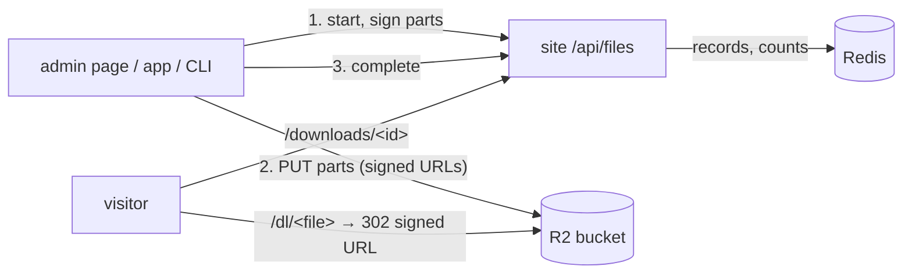

# puddings-world

GeniusPudding's personal website

## Stack

Next.js 15 · React 19 · TypeScript · Tailwind v4

## Install & run

```bash
./scripts/setup.sh && ./scripts/dev.sh    # macOS/Linux
./scripts/setup.ps1; ./scripts/dev.ps1    # Windows
```

App at <http://localhost:3000>.

## Check

```bash
pnpm check        # typecheck + unit tests (node:test via tsx)
pnpm test         # unit tests only — tests/**/*.test.ts
```

## Deploy

```bash
./scripts/deploy.sh                # Vercel (default)
DOCKER=1 ./scripts/deploy.sh       # Docker → Cloud Run / Fly.io
```

## Structure

- `app/` — pages + API routes (App Router)
- `app/api/<name>/route.ts` — backend endpoints
- `content/` — hand-authored content (musings, interests, external projects)
- `data/projects.json` — generated project snapshot (do not edit; see below)
- `lib/projects.ts` — loads the snapshot, groups and sorts by track
- `lib/analytics.ts`, `lib/admin-auth.ts`, `lib/event-log.ts` — admin dashboard
- `lib/files/`, `scripts/upload.ts` — shared files in R2 (`/downloads`, `/admin/files`)
- `scripts/fetch-projects.ts` — the generator
- `Dockerfile` — multi-stage build for self-host

## Home page "Now building"

`content/now.ts` holds the weekly "Now building" cards (regenerated by the
assistant hub, merged via PR). Each item has a `title`, a `note` in which
`**double asterisks**` mark the one or two phrases to bold, an optional
`href` (public repo or on-site page) and an optional `image` under
`public/now/` (16:9, 1280×720, served unoptimized). Items without an image
get a monogram tile. Cards with an image are listed first (`lib/now.ts`),
otherwise in file order. The first four render open; the rest sit behind a
native `<details>` toggle.

## Contact form

`/contact` has a message form (`components/ContactForm.tsx`) that posts to
`POST /api/contact` with JSON `{ name?, email?, message, website? }`.
Validation lives in `lib/contact.ts` (`parseContact`, `renderEmail`): the
message is required (max 2000 chars), name and email are optional, and a
filled `website` field is a honeypot that is accepted and silently dropped.
Each IP (hashed) may send 3 messages per 10 minutes.

Every accepted message is pushed to the Redis list `contact:messages`
(newest 500 kept, readable in the Upstash console) and, when
`RESEND_API_KEY` is set, emailed through Resend with the sender's address
as reply-to. Env vars:

- `RESEND_API_KEY` — enables email delivery.
- `CONTACT_TO` — recipient (default `geniuspuddingforgames@gmail.com`).
- `CONTACT_FROM` — sender (default `puddingsworld <onboarding@resend.dev>`;
  Resend's test sender only delivers to the Resend account's own address,
  so verify the domain before changing `CONTACT_TO` to anything else).

With neither Redis nor Resend configured the endpoint answers 503.

## Musings from Google Docs

`/musings` shows the hand-written pieces in `content/musings.ts` plus
whatever the Google Docs listed in `content/musing-sources.ts` hold right
now (`lib/musings.ts` `loadMusings`). Each source is a doc link or a Drive
folder link shared as "Anyone with the link: Viewer", with a `kind`:

- `lyrics`: one song per doc, or a heading (`# 歌名`) / `---` line starts
  each song. A doc with no heading names its only song after the doc title
  (minus `.docx` and a trailing `歌詞` / `lyrics`), and drops a first line
  that just repeats it. An `audio: <url>` line (also `mp3` / `demo` / `音檔`
  / `音樂` / `錄音`) attaches a recording: a Drive file link (shared
  publicly) becomes a direct download URL; other https URLs are used as is.
  A `cover: line one / line two` line (also `hook` / `封面`) picks the words
  on the song's card; without it the card shows the line the song repeats
  most plus the next one (`hookOf`), or its opening two lines.
- `sayings`: one per paragraph or bullet; a following line starting with
  `—` is its context (a trailing year or date in it becomes the date).
- `auto`: headings or separators mean lyrics, otherwise sayings.

A line holding only a date (`2023-05-01`, `2023.5`, `日期：2023`) dates the
piece. Docs are read through the public export URL
(`/document/d/<id>/export?format=md`, falling back to `txt`; the title comes
from `Content-Disposition`), folders through `embeddedfolderview` (Docs
only, up to 60). Fetches are cached for 10 minutes and the pages revalidate
on the same window, so an edit in Docs shows up within about 10 minutes
without a deploy. A doc that can't be read is skipped and logged. Parsers
are pure (`lib/gdocs.ts`); fetching is in `lib/gdocs-fetch.ts`.

`/musings/lab` (unlinked, `noindex`) previews links before they are listed:
paste doc or folder links (several lines at once split into rows), pick a
kind, and `POST /api/musings/preview` with `{ sources: [{ url, kind }] }`
(max 20) returns per-source results plus the parsed `musings` and `sayings`,
rendered with the real carousels. The preview skips the cache. Rows are
remembered in the browser's localStorage only.

Lyrics render in a coverflow carousel that autoplays every 7 s (pauses on
hover, stops after interaction). Each song is a record-sleeve card: its
title written vertically in the background, the two cover lines, the title,
and a disc that turns while the song plays; the full words only appear
inside. Sayings sit in a strip that steps one card every 6.5 s
(`SAYING_DWELL_MS`) with a slow 1.8 s glide.

A song with a recording gets a listen button. Browsers block sound until a
click, so playback only starts from that button; after it, the music
follows the carousel (switching cards switches songs, a finished song
advances to the next card, and the 7 s autoplay stops). Songs without a
recording show "recording coming soon".

Clicking the focused card opens the song with a view transition
(`components/MusingTransition.tsx`): the card's title and disc glide into
the page heading and player, then the stanzas surface one by one, choruses
(stanzas sung more than once, `stanzasOf`) marked with an amber rule.
The focused card's page is prefetched whenever the carousel settles, and
the transition waits at most 0.8 s for it (the page is frozen meanwhile);
a slower page simply arrives without the glide. Browsers without view
transitions, or with reduced motion, just navigate.
The detail page's disc spins while its player plays.

## Admin dashboard and analytics

`/admin` is unlinked and `noindex`. Without a session it shows a password
form that posts `{ password }` to `POST /api/admin/login`; the password is
the `ADMIN_PASSWORD` env var (no var, no login). A correct password sets an
httpOnly cookie holding `<expiry>.<HMAC>` keyed by that password
(`lib/admin-auth.ts`), valid 30 days; changing the password signs every
session out. Five wrong passwords per hashed IP lock login for 15 minutes.
`POST /api/admin/logout` clears the cookie.

The dashboard shows, for the last 7 / 30 / 90 days (`/admin?days=`): views
per day, daily unique visitors, top pages, traffic sources, visitor
countries, the latest 50 contact messages and the latest 100 activity-log
entries.

Page views come from `components/PageviewBeacon.tsx` (root layout), which
sends `{ path, referrer?, utm? }` to `POST /api/track` on every route change,
with the referrer and `utm_source` only on the landing page. The route skips
bots, `/api`, `/admin` and signed-in admins, then updates per-day Redis keys
(Taipei calendar days, kept 400 days): `stats:<day>:views` (hash path →
count), `stats:<day>:uv` (HyperLogLog of hashed IPs),
`stats:<day>:refs` (hash source → count) and `stats:<day>:countries` (from
Vercel's `x-vercel-ip-country`). The source is `utm_source` if given, else
the referrer host without `www.`; internal and preview referrers are
ignored. Pure helpers live in `lib/analytics.ts`.

Visitor IPs are never stored, only `hashIp` (`lib/ktv/rate-limit.ts`),
which the stats, the admin login lockout, the contact form and Street KTV
quotas share. Set `IP_HASH_SALT` (any long random string) to key it with
HMAC-SHA256; without it the hash is a plain SHA-256, which anyone holding
the data could reverse by hashing every IPv4 address. Setting or changing
the salt changes every hash once: that day's unique visitors count returning
people twice, and running per-IP limits start over.

`lib/event-log.ts` `logEvent(type, detail?)` appends to the Redis list
`log:events` (newest 1000). Logged today: `contact.message`, `admin.login`,
`admin.login_failed`, and the `files.*` events below.

## Shared files (`/downloads`)

Large files (datasets, models, installers: anything too big for a repo)
live in a **private Cloudflare R2 bucket**. Nothing is listed publicly:
each collection has an unguessable 16-character id, and only people (or
apps) holding its link can see it. Bytes never pass through Vercel, so
there is no 4.5 MB request limit and downloads cost no Vercel bandwidth
(R2 egress is free).



**Set up once**

1. Cloudflare → R2 → create bucket `puddings-files` (leave public access off).
2. R2 → Manage API tokens → create one with *Object Read & Write* on that
   bucket only.
3. Bucket → Settings → CORS policy (lets the admin page PUT parts and read
   their ETag):
   ```json
   [{ "AllowedOrigins": ["https://puddings-world.com", "http://localhost:3000"],
      "AllowedMethods": ["PUT"], "AllowedHeaders": ["*"],
      "ExposeHeaders": ["ETag"], "MaxAgeSeconds": 3600 }]
   ```
4. Vercel env (Production): `R2_ACCOUNT_ID`, `R2_ACCESS_KEY_ID`,
   `R2_SECRET_ACCESS_KEY`, optionally `R2_BUCKET` (default `puddings-files`).
   Redeploy. Until then `/admin/files` shows these steps and the APIs answer 503.

**Use it**

- `/admin/files` (signed in): create a collection, drop files on it,
  *copy share link* → `https://puddings-world.com/downloads/<id>`. Uploads
  go in parts (16 MiB or more, 4 at a time, each retried 4 times); if one
  stops, pick the same file again and it resumes from the parts R2 already
  has (progress kept in the browser's localStorage). Unfinished uploads are
  marked and can be deleted; R2 also drops abandoned multipart parts after
  7 days.
- `/downloads/<id>`: link holders tick the files they want, then
  *download* (one after another) or *copy links* for a download manager.
  Each file shows its size, note and SHA-256 when the uploader sent one.
  The page is `noindex`; `/downloads` itself only explains that files are
  shared by link.
- `/dl/<fileId>`: counts the download (bots excluded) and redirects to an
  R2 URL signed for 10 minutes, saving under the original name (non-ASCII
  names included).
- **Apps and scripts**: create an app token at `/admin/files`, scoped to some
  collections or all; the secret (`pwf_…`) is shown once and only its
  SHA-256 is stored. Revoking takes effect at once.

  ```sh
  PW_FILES_TOKEN=pwf_… npx tsx scripts/upload.ts --collection <id> [--note "…"] [--site URL] [--no-hash] build/app.zip data/*.tar
  # app.zip (812.4 MB)
  #   done  sha256 9f86d0…
  # Share: https://puddings-world.com/downloads/<id>
  ```

  It hashes each file (skip with `--no-hash`), uploads it in parts, and
  resumes an interrupted file when run again (state under the OS temp dir).
  Defaults: `--site` from `PW_SITE`, else `https://puddings-world.com`.

**API** (JSON; admin = `/admin` session cookie, app = `Authorization: Bearer pwf_…`)

| Method & path | Who | Does |
|---|---|---|
| `GET /api/files/collections` | admin | All collections with every file and download count |
| `POST /api/files/collections` `{title, note?}` | admin | Create a collection |
| `GET /api/files/collections/<id>` | link holder | Collection and its finished files |
| `DELETE /api/files/collections/<id>` | admin | Delete it and its files in R2 |
| `DELETE /api/files/files/<id>` | admin | Delete one file / abandon its upload |
| `POST /api/files/uploads` `{collectionId, name, size, type?, sha256?, note?}` | admin, app in scope | Start → `{fileId, partSize, partCount}` |
| `POST /api/files/uploads/<id>/parts` `{parts:[n…]}` | same | Up to 100 signed PUT URLs, valid 1 h |
| `POST /api/files/uploads/<id>/complete` `{parts:[{part, etag}]}` | same | Stitch parts; checks the stored size |
| `GET/POST /api/files/tokens`, `DELETE /api/files/tokens/<id>` | admin | List, issue, revoke app tokens |
| `GET /dl/<fileId>` | link holder | Count and redirect to a signed download |

Limits: 200 GiB per file, names cleaned of paths and characters Windows
refuses. Code: `lib/files/` (`model.ts` pure rules, `upload-client.ts` the
uploader shared by browser and CLI, `r2.ts` S3 signing via `aws4fetch`,
`store.ts` Redis records, `secrets.ts` ids and token hashes). Events:
`files.collection_created`, `files.collection_deleted`, `files.uploaded`,
`files.deleted`, `files.token_created`, `files.token_revoked`.

## Projects: discovered from GitHub

`/projects` is not hand-maintained. A weekly GitHub Action
(`.github/workflows/fetch-projects.yml`) runs `pnpm fetch-projects`, which:

1. Lists every repo this account owns or belongs to and keeps the ones tagged
   with the **`puddings-world`** topic.
2. Picks the track from a plain topic: `research` → Research, `tool` → Tools,
   anything else → Side Projects.
3. Derives status: GitHub `archived` → archived; pushed within 90 days →
   active; otherwise paused.
4. Reads an optional `.puddings.json` at the repo root (schema: `Manifest` in
   `lib/types.ts`) that overrides any derived field — title, tagline, long
   description, track, status, hero image, links, `featured`, `hidden`,
   `order`, `progress`.
5. Reads `CITATION.cff` if present and renders it as the project's paper.
6. Attaches stars, open issues, weekly commits, latest commit and release.
7. Appends `content/external-projects.ts` — repos this account cannot tag.

A screenshot at `public/projects/<slug>.{jpg,png,webp}` (16:9, 1280×720,
under ~150 KB) becomes the card's thumbnail unless the manifest sets
`image`; this is how private repos get one. Inside a track, projects sort by manifest `order`, then
their place among the repos pinned on the GitHub profile (then the
`puddings-world` org; read over GraphQL, so only with a token), then
`featured`, then most recent push. Above the tracks, `/projects` shows a
"Pinned & recently active" row (`spotlight`): every pinned project in pin
order, then the three other projects pushed to most recently in the last
30 days. Pins are read when the snapshot is built, so re-pinning shows up
on the next weekly refresh. Remaining GitHub topics become
the card's tags. Private repos are shown
without a link. Manifest text is published verbatim, so write it as public
copy even on private repos.

`progress` is a public roadmap, shown even for private repos: a list of
`{ "title": "...", "status": "done" | "doing" | "next", "note"?: "..." }`,
oldest step first. The card gets a done/total bar plus the current
(`doing`) step, and the project page lists every milestone. Malformed
entries are dropped (`normalizeProgress` in `lib/progress.ts`).

```json
{
  "progress": [
    { "title": "Prototype", "status": "done" },
    { "title": "Closed beta", "status": "doing", "note": "10 testers" },
    { "title": "Public launch", "status": "next" }
  ]
}
```

To put a repo on the site: add the `puddings-world` topic plus one of
`research` / `tool` / `side-project` on GitHub. To take it down: remove the
topic, or set `"hidden": true` in its manifest.

Run locally with a token to include private repos:

```bash
GH_PAT=$(gh auth token) pnpm fetch-projects
```

The Action needs a `GH_PAT` repository secret (fine-grained token, read-only
on contents + metadata for the repos to show) for private repos and a higher
rate limit; without it only public repos are discovered.

Created 2026-04-28.
